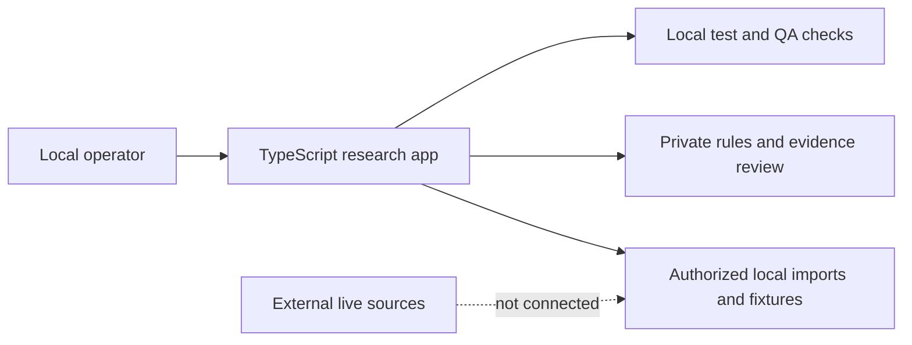

# DomScout

Domain discovery with the evidence in view. A local TypeScript research workspace with a white/orange original identity, durable authorized imports, explicit unknowns and private per-user rules.

```
npm ci
npm run check
npm run owner:create -- owner@example.com
npm run dev
```

Visit http://127.0.0.1:4310. Public inventory starts empty; Explore samples opens clearly labeled fixtures. No real source feed, message delivery or deployment is claimed. Paid connectors, billing, WhatsApp and the developer API stay disabled. No automatic bids or purchases. Trademark not checked; independent review required. No video work.

[Owner guide](docs/README_FOR_OWNER.md) · [Setup](docs/SETUP.md) · [Operations](docs/OPERATIONS.md) · [Progress](PROGRESS.md) · [Complete original brief](docs/MASTER_SPEC.md) · [Research coverage](docs/RESEARCH_COVERAGE.md) · [Source registry](docs/SOURCE_REGISTRY.md) · [Visual QA](docs/qa/README.md)

---

## Cloud Engineering & DevOps

*Project-specific implementation record for technical interviews and portfolio review. Items below distinguish completed work from unverified or planned infrastructure.*

### Cloud platforms
- **Local-first prototype.** The repository does not currently verify a publicly hosted production service, managed cloud database or always-on background worker.
- Local Node.js/TypeScript development and owner/private-rule setup are documented; no public cloud deployment is claimed.

### DevOps & CI/CD
- npm-based checks, Node test runner and Playwright browser QA are documented.
- Source-controlled import and evidence workflows are implemented. No verified Docker Compose, deployed GitHub Actions pipeline, Terraform or Kubernetes is claimed.

### Networking & API engineering
- Domain parsing and authorized-source ingestion logic; research/adapters must not be represented as live DNS monitoring or active RDAP services.
- Local authentication/data isolation and API integration boundaries can be studied in the code.

### Monitoring & reliability
- Operations notes, source provenance, regression checks and visual QA records support reproducibility.
- No live source feeds, verified Telegram delivery, uptime measurements or backup/restore drill are claimed.

### Architecture & infrastructure diagram



**Deployment:** Local development: http://127.0.0.1:4310 — no verified public deployment

**Technical documentation and proof:** [Setup](docs/SETUP.md) · [Operations](docs/OPERATIONS.md) · [Source registry](docs/SOURCE_REGISTRY.md) · [Progress and limits](PROGRESS.md) · [Visual QA](docs/qa/README.md).

**Evidence boundary:** This project demonstrates local software/test engineering, **not** an operational cloud deployment or tested DNS monitoring service.
